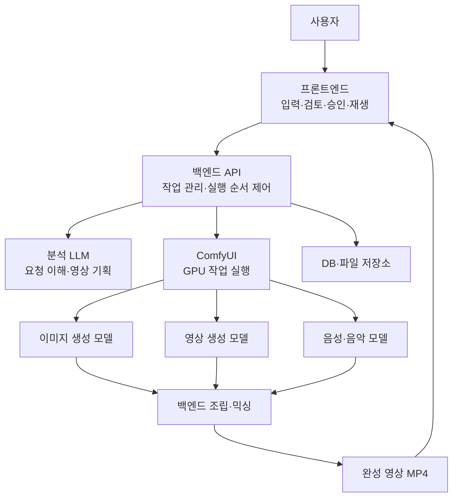

현재 코드와 설정, 운영 기록을 확인해 프로젝트의 전체 흐름부터 설명하겠습니다. LLM·영상 생성 모델·ComfyUI가 각각 맡는 역할과 현재 연결된 모델도 함께 정리하겠습니다.

이 프로젝트는 **사용자가 광고 내용을 입력하면, 여러 AI 모델을 순서대로 실행해 영상·목소리·음악을 만들고 하나의 완성 영상으로 조립하는 서비스**입니다.

AI 하나가 모든 일을 하는 구조가 아니라, **기획·이미지·영상·음성을 담당하는 AI들과 이를 관리하는 백엔드가 협업하는 구조**로 이해하면 됩니다.

**전체 구조는 다음과 같습니다.**



**LLM은 요청을 이해하고 제작 계획을 세우는 AI입니다.**

LLM은 *Large Language Model*, 즉 대규모 언어 모델입니다. 사용자가 입력한 문장을 이해하고, 문장이나 구조화된 데이터를 만들어 냅니다.

예를 들어 사용자가 다음처럼 입력했다고 생각하면 됩니다.

> “제주도 렌터카를 홍보하는 30초 광고를 만들어 줘. 가족이 차를 타고 해안도로를 달리는 장면이 필요해.”

이 프로젝트의 LLM은 이런 내용을 바탕으로 다음 작업을 합니다.

- 광고의 의도와 브랜드 정보 정리
- 장면·구간 구성과 등장인물 설정
- 대사·나레이션과 화면 설명 작성
- 필요한 이미지 판단
- 영상 생성 모델에 전달할 제작 계획 작성
- “차가 달리는 장면을 비 오는 길로 바꿔줘” 같은 수정 요청 해석

여기서 만들어지는 결과는 주로 **영상 제작을 위한 계획 데이터**입니다. 실제 움직이는 화면은 이후 영상 생성 모델이 만듭니다.

**현재 어떤 모델을 사용하는지는 환경별로 봐야 합니다.**

현재 로컬 설정과 **11월 11일 서버 운영 기록**을 대조하면 다음과 같습니다. 서버 설정은 오늘 SSH로 직접 재확인한 값은 아닙니다.

| 담당 | 모델·구성 | 현재 확인된 상태 |
|---|---|---|
| 서버의 분석 LLM | **Gemma 4 12B**, llama.cpp 실행 | 운영 기록상 사용 |
| 이 PC의 분석 LLM 설정 | **`gemini-3.5-flash-lite`** | 로컬 `.env` 설정값. 이번 설명 과정에서 외부 API 호출은 하지 않음 |
| 서버의 이미지 생성 | **Qwen-Image 2512 + Lightning** | 운영 전환 기록 있음 |
| 서버의 영상 생성 | **LTX-2.5** | 최신 인수인계 기록상 `RENDER_ENGINE=ltx` |
| 이전 영상 생성 경로 | **MiniMax H3** | 기존 구현과 수정 경로 등에 남아 있음 |
| 대안 영상 모델 | **Wan 계열·InfiniteTalk** | 시험 중. 일부 결과 합격, 전체 운영 전환은 아직 결정 단계 |
| 목소리 생성 | **Qwen3-TTS·VoxCPM2 조합** | 음성 디자인·복제 경로 |
| 배경음악 생성 | **ACE-Step 1.5 XL** | BGM 생성 |
| 소리 분리·정리 | **SAM-Audio** | 렌더 결과에서 불필요한 음악·말소리 등을 분리 |
![[STAR_AI 사용 모델 및 분석.png]]

따라서 지금 서버 쪽 구성을 대표적으로 말하면 **“Gemma로 기획하고, Qwen-Image로 이미지를 만들고, LTX로 영상을 생성하는 구조”**입니다. Wan은 그 영상 생성 부분을 대체할 수 있는지 시험하는 중입니다. [현재 운영 기록](D:/lee/company/project/ijaksnc_project/tf_ai_group/Star_ai/HANDOFF.md:5)

참고로 로컬 설정의 `openai_compatible_chat`은 **API 통신 형식의 이름**입니다. 그 이름만으로 실제 사용하는 모델이 OpenAI 모델이라고 판단하면 안 됩니다.

**ComfyUI는 이 모델들을 연결해서 실행하는 프로그램입니다.**

ComfyUI는 모델 이름이 아닙니다. 이미지·영상·음성 AI의 실행 과정을 **노드라는 처리 블록으로 연결하는 도구**입니다.

예를 들어 영상 생성 작업은 개념적으로 다음처럼 구성됩니다.

```text
모델 불러오기
    ↓
프롬프트·시작 이미지·대사 음성 입력
    ↓
영상 생성 계산
    ↓
생성 결과를 영상으로 변환
    ↓
파일 저장
```

이러한 연결 전체를 **워크플로(workflow)**라고 부릅니다.

사람은 ComfyUI 화면에서 블록을 연결할 수 있고, 이 프로젝트의 백엔드는 그 연결 정보를 **JSON 형태로 만들어 ComfyUI API에 제출**합니다. 따라서 사용자가 광고를 만들 때마다 개발자가 ComfyUI 화면에서 직접 버튼을 누르는 방식은 아닙니다.

서버 기록의 `comfyui_llama`는 분석 LLM도 ComfyUI 작업 안에서 llama.cpp로 실행한다는 뜻입니다. 큰 모델들이 같은 GPU 메모리를 사용하므로, 실행 순서와 모델을 올리고 내리는 관리가 중요합니다.

**영상 생성 모델은 실제 움직이는 화면을 만드는 AI입니다.**

영상 생성 모델은 글·이미지·음성 등의 조건을 받아 여러 프레임을 생성합니다. 여기서 자주 나오는 용어는 다음과 같습니다.

| 용어 | 의미 | 예시 |
|---|---|---|
| T2V | Text to Video, 글로 영상 생성 | “자동차가 해안도로를 달린다” |
| I2V | Image to Video, 이미지로 영상 생성 | 자동차 사진을 시작 화면으로 움직임 생성 |
| T2I | Text to Image, 글로 이미지 생성 | 광고에 사용할 가족과 자동차 이미지 생성 |
| TTS | Text to Speech, 글을 음성으로 변환 | 대사 문장을 실제 목소리로 생성 |
| 립싱크 | 입 움직임과 음성의 타이밍을 맞춤 | 등장인물이 준비된 대사를 말하도록 생성 |

이 프로젝트에서 **키 이미지**를 만드는 이유도 여기에 있습니다. 등장인물·차량·배경의 모습을 먼저 정해 두고 영상 생성에 사용하면, 장면마다 외형이 바뀌는 문제를 줄이는 데 도움이 됩니다.

대사는 먼저 TTS로 만들고 영상 생성의 조건으로 활용할 수 있습니다. 화면 밖에서 설명하는 나레이션은 별도 음성으로 만들어 조립합니다.

**백엔드는 전체 제작 과정을 관리하는 프로그램입니다.**

이 저장소의 백엔드는 **Python·FastAPI**로 작성돼 있습니다. 사용자의 API 요청을 받고 다음을 관리합니다.

- 로그인·권한과 생성자 정보
- 요청 분석, 이미지 검토·승인
- AI 실행 순서와 작업 상태
- 실패 처리·재시도
- 영상·음성·음악 조립
- 완성 영상 조회·검색·수정·삭제
- 대시보드 통계

영상 생성은 시간이 오래 걸리므로, 작업을 접수한 뒤 **worker라는 백그라운드 처리 코드**가 계속 실행합니다. 프론트는 작업 상태를 주기적으로 조회해 “분석 중”, “생성 중”, “완료”를 표시합니다.

영상 조립에는 **ffmpeg**를 사용합니다. ffmpeg는 동영상을 자르고 이어 붙이거나 음성을 섞는 미디어 처리 프로그램이며, 생성 AI 모델과는 역할이 다릅니다.

**데이터는 DB와 파일 저장소에 나누어 보관합니다.**

- **PostgreSQL:** 계정·세션·생성자 연결·삭제 기록 등
- **파일 저장소:** 요청·분석·작업 기록 JSON, 이미지·음성·완성 영상 파일
- **GPU 서버의 모델 폴더:** AI의 학습 결과가 들어 있는 큰 모델 파일

모델 파일은 흔히 **가중치(weights)** 라고 부릅니다. 현재 프로젝트는 준비된 모델 가중치를 불러와 결과물을 만드는 **추론(inference)**이 중심입니다.

**Docker는 이 프로그램을 실행 환경째 묶는 방법입니다.**

어제 다시 올린 로컬 Docker 구성은 다음 두 개입니다.

- `backend`: API와 작업 관리 프로그램
- `postgres`: 데이터베이스

GPU 모델과 ComfyUI는 별도로 관리됩니다. 백엔드는 설정된 주소를 통해 해당 실행 환경과 통신합니다.

현재 이 PC는 기존 설정인 `VIDEO_GENERATION_ENABLED=false`를 유지하고 있으므로, 조회·검색 API는 사용할 수 있지만 영상 생성 실행은 꺼져 있습니다.

실제 사용 흐름으로 연결하면 **“프론트에서 요청 → 백엔드가 접수 → LLM이 기획 → 이미지·음성·영상 모델 실행 → 백엔드가 조립 → 라이브러리에서 조회·수정”** 순서입니다.